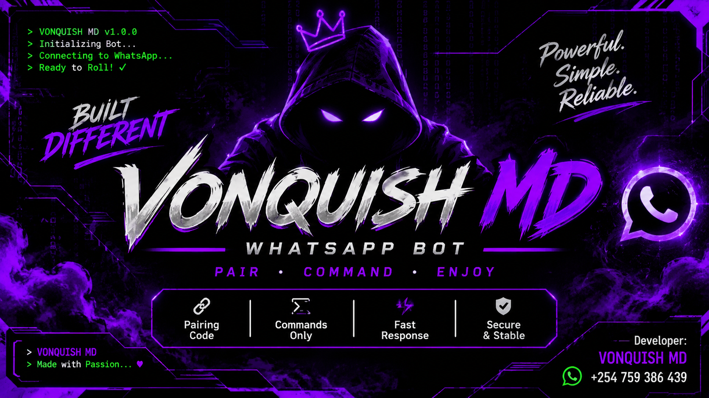

# 💜 VONQUISH MD

### A Powerful WhatsApp Bot

VONQUISH MD is a WhatsApp automation project built with Node.js and Baileys.

A simple, command-based WhatsApp bot designed for a clean experience.

## 🚀 Quick Links

- 📱 [How to Get a WhatsApp Pairing Code](PAIRING.md)
- ☁️ [How to Deploy VONQUISH MD](DEPLOYMENT.md)
- 💻 [Installation Guide](#installation)
- 📋 [Bot Commands](#commands)
- 👑 [Contact Developer](#developer)

## ✨ Features

- 🔐 WhatsApp pairing-code connection (experimental)
- 🤖 Command-based bot
- 💜 No automatic greeting replies
- ⚡ Fast command responses
- 💾 Local session storage

## 📋 Commands

| Command | Description |
|---|---|
| `.menu` | Display bot commands |
| `.help` | Show help information |
| `.alive` | Check bot status |
| `.ping` | Test bot response |
| `.owner` | Contact the developer |

## 🛠️ Technologies

- Node.js
- JavaScript
- Baileys
- Express
- Supabase

## 💻 Installation

1. Clone the repository:

   `git clone https://github.com/Sydney-ai-hub/VONQUISH-MD.git`

2. Open the project folder:

   `cd VONQUISH-MD`

3. Install dependencies:

   `npm install`

4. Start the local bot:

   `node index.js`

5. Follow the pairing instructions in your terminal.

## ☁️ Deployment

Want to run VONQUISH MD online?

Read our [Deployment Guide](DEPLOYMENT.md).

Deployment is not yet fully configured. Follow the guide and check that your hosting setup supports persistent WhatsApp sessions.

## ⚠️ Disclaimer

VONQUISH MD is an independent, unofficial project and is not affiliated with WhatsApp or Meta.

Pairing is experimental and may not work reliably yet.

Only connect WhatsApp accounts you own or have permission to use.

Never share your pairing code or session credentials.

## 💜 Developer

**VONQUISH MD**

📱 WhatsApp: [+254 759 386 439](https://wa.me/254759386439)

Built with passion.

---

⭐ If you like this project, consider giving it a star!
